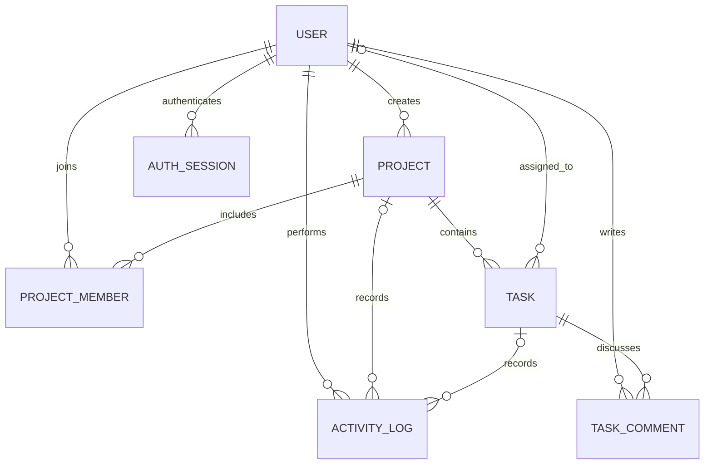

# Fieldwork | Project & Team Management

A full-stack project workspace for organizing projects, assigning work, tracking delivery, and keeping decisions close to the tasks they affect.

## Stack

- Web: React 19, TypeScript, Vite, React Router, Axios
- API: NestJS 11, TypeScript, class-validator
- Data: MySQL 8, Prisma ORM
- Authentication: bcrypt-hashed passwords and revocable random bearer sessions; only token hashes are persisted
- Tests: Vitest across both workspaces, with Testing Library for the web client

The repository uses npm workspaces. The web client calls the REST API under `/api`; Vite proxies those requests to NestJS during local development.

## Requirements

- Node.js 20.19+ (or 22.12+) and npm 10+
- Docker Desktop with Compose, or a MySQL 8 database you control

## Local Setup

1. Install packages:

   ```powershell
   npm install
   ```

2. Create local-only environment files from the placeholders and set unique local secrets:

   ```powershell
   Copy-Item .env.example .env
   Copy-Item apps/api/.env.example apps/api/.env
   ```

   Set `MYSQL_ROOT_PASSWORD` and `MYSQL_PASSWORD` in the root `.env`. Set `DATABASE_URL`, `ADMIN_EMAIL`, and a 12–72-character `ADMIN_PASSWORD` in `apps/api/.env`. The app database credentials in `DATABASE_URL` must match the root Compose `MYSQL_USER` and `MYSQL_PASSWORD`. Both `.env` files are ignored by Git.

3. Start the included local MySQL service (Docker option):

   ```powershell
   docker compose up -d mysql
   ```

   Compose credentials are supplied through the ignored root `.env`; do not use them outside local development. For an existing MySQL server, create a database and least-privilege application account, then configure only `apps/api/.env`.

4. Generate the Prisma client, apply the checked-in migration, and create the first administrator:

   ```powershell
   npm run db:generate
   npm run db:migrate
   npm run db:seed
   ```

   The seed reads `ADMIN_NAME`, `ADMIN_EMAIL`, and `ADMIN_PASSWORD` from `apps/api/.env`; it creates one example project with tasks and a comment for the dashboard. The configured email must be unused or already belong to an admin; the seed refuses to promote or modify an existing non-admin account. Public registration is limited to 5 requests per hour per client and creates team-member accounts with a 12-character minimum password; login is limited to 8 attempts per minute.

5. Start the API and frontend:

   ```powershell
   npm run dev
   ```

   Open `http://localhost:5173`. The API listens on `http://localhost:3000/api`. The optional web environment file is `apps/web/.env.example`.

Useful commands:

```powershell
npm run build
npm test
npm run db:studio --workspace @team-management/api
 npm run db:deploy
docker compose down
```

Use `db:migrate` for local development. For a production database, apply checked-in migrations with `npm run db:deploy`; it does not reset the database. Do not use `prisma migrate dev` against production.

`docker compose down` stops the local service without removing its volume. To remove the local database volume, use `docker compose down -v`; that permanently deletes the local Compose database.

## Roles and Permissions

| Role | Organization access | Project access |
| --- | --- | --- |
| Admin | Manage users and roles; access all active projects | Create, update, archive projects; manage all tasks and team assignments |
| Project manager | Create projects; list team members for assignment | Manage only projects where they are a project-manager member |
| Team member | Register and sign in | View projects they belong to, comment on accessible tasks, and change status only on tasks assigned to them |

Backend guards and project-membership checks enforce these rules. Frontend visibility is only a usability layer. New registrations always receive the `TEAM_MEMBER` role; admin promotion/demotion uses the user-management endpoint. Administrators cannot change their own role; a manager can only be demoted after another project manager is assigned to each project they manage.

## Data Model

The relational model is normalized around users and projects. `ProjectMember` is the join table for project membership and per-project manager/member access. A task belongs to one project, may have one assignee, and records its creator. Comments belong to a task and author. Activities retain an entity ID and event detail; nullable relations allow task deletion to leave a deletion event behind. Auth sessions store SHA-256 token hashes and expire independently.



Indexes cover membership lookups, status/assignee/due-date filtering, and timeline queries. Task results use database-backed pagination, validated sort fields, and related project/assignee selects to avoid per-row follow-up queries.

## API

All routes are prefixed with `/api`. Protected routes require `Authorization: Bearer <session-token>`. Login and registration return `{ token, expiresAt, user }`; `/auth/me` returns only public user fields. Logout deletes the current session. Request validation rejects unknown fields. Errors use `{ statusCode, error, message, timestamp, path }`; unexpected internal errors do not expose exception text.

Paginated list routes return `{ "data": [], "pagination": { "page", "limit", "total", "pages" } }`. Successful create routes return the created resource with HTTP 201; reads and updates return a resource with HTTP 200. Common failures use HTTP 400 for invalid input, 401 for missing/expired credentials, 403 for insufficient role, 404 for inaccessible resources, and 409 for duplicate or conflicting state. Validation errors include a `message` array.

| Method | Route | Access | Purpose |
| --- | --- | --- | --- |
| POST | `/auth/register` | Public, throttled | Register a team member |
| POST | `/auth/login` | Public, throttled | Authenticate and create a session (HTTP 200) |
| GET | `/auth/me` | Signed in | Read current user |
| POST | `/auth/logout` | Signed in | Revoke current session (HTTP 200) |
| GET / POST | `/projects` | Signed in / Admin or manager | List accessible projects / create |
| GET | `/projects/:id?taskPage=1` | Project member | Read project details and one page of associated tasks |
| PATCH | `/projects/:id` | Project manager or admin | Update project fields |
| PATCH | `/projects/:id/archive` | Project manager or admin | Archive a project |
| POST | `/projects/:id/members` | Project manager or admin | Add a team member |
| DELETE | `/projects/:id/members/:userId` | Project manager or admin | Remove a team member |
| GET / POST | `/tasks` | Signed in / Admin or manager | Filtered task list / create |
| GET / PATCH / DELETE | `/tasks/:id` | Project member / scoped by role | Read, update, or delete a task |
| GET / POST | `/tasks/:id/comments` | Project member | Read or add task comments |
| GET | `/dashboard/summary` | Signed in | Database-derived progress metrics |
| GET | `/users` | Admin or project manager | Search the user directory for team assignment |
| PATCH | `/users/:id/role` | Admin | Change organization role |

Authentication example:

```json
POST /api/auth/login
{
   "email": "admin@example.com",
   "password": "<configured locally>"
}
```

```json
HTTP 200
{
   "token": "<opaque session token>",
   "expiresAt": "<ISO timestamp>",
   "user": { "id": "<id>", "name": "Workspace Admin", "email": "admin@example.com", "role": "ADMIN" }
}
```

Task filters include `projectId`, `assigneeId`, `priority`, `status`, `search`, and `overdue=true`; `page`, `limit`, `sortBy`, and `sortOrder` control result windows. Project detail task rows are also database-paginated with a 20-task page. Task statuses are `TODO`, `IN_PROGRESS`, `IN_REVIEW`, and `DONE`; priorities are `LOW`, `MEDIUM`, `HIGH`, and `CRITICAL`. Project statuses are `PLANNING`, `ACTIVE`, `ON_HOLD`, and `COMPLETED`.

Example task creation:

```json
{
  "title": "Review onboarding flow",
  "description": "Confirm the revised first-run experience",
  "projectId": "project-id",
  "assigneeId": "user-id",
  "priority": "HIGH",
  "dueDate": "2026-11-15"
}
```

Project creation accepts `name`, `description`, `startDate`, `deadline`, optional `status`, and optional `memberIds`. Project edits accept the editable project fields only. Task edits accept the task fields; team members may submit only `{ "status": "IN_PROGRESS" }` for a task assigned to them. A comment request is `{ "body": "The first navigation pass is ready for review." }`.

Task and project lists return the same pagination envelope shown below. The dashboard summary includes project totals/status counts, task totals/status counts, overdue tasks, assigned-to-me tasks, and aggregate completion percent.

```json
{
   "data": [],
   "pagination": { "page": 1, "limit": 20, "total": 0, "pages": 0 }
}
```

Errors use this shape; validation `message` may be an array. Unexpected server errors use a generic message and never return exception detail.

```json
{
   "statusCode": 400,
   "error": "Bad Request",
   "message": ["title must be longer than or equal to 3 characters"],
   "timestamp": "<ISO timestamp>",
   "path": "/api/tasks"
}
```

## Tests

```powershell
npm test
```

The API tests cover password authentication, registration password constraints and role assignment, logout revocation, normalized errors, role guards, project/task creation, required-field validation, project/task access boundaries, member task-status permissions, task capabilities, overdue filtering, and database pagination. They mock Prisma so they run without a database. The web tests cover shared status and empty-state rendering.

## Screenshots and Demo

`screenshots/login.png` shows the rendered sign-in page. Before submission, capture these screens from the seeded application at desktop and mobile widths and save them in `screenshots/`:

- `dashboard.png`
- `projects.png` and `project-details.png`
- `tasks.png` and `task-details.png`
- `team.png`

No mock-data screenshots are presented as live database output. No hosted live demo is configured, and no production/demo credentials are included in this repository.

## Deployment Guide

No deployment has been performed. A production deployment is feasible with a managed MySQL 8 service, a Node.js host for NestJS, and a static host for Vite:

1. Create a dedicated production database and least-privilege database account. Require TLS for the database connection where supported.
2. Deploy the API from the repository root. Build with `npm ci`, `npm run db:generate`, and `npm run build`; start with `npm run start --workspace @team-management/api`. Configure `DATABASE_URL`, `PORT` (provided by the host), `WEB_ORIGIN` (the exact HTTPS frontend origin), and `SESSION_TTL_HOURS` as host secrets/environment values.
3. Before serving traffic, run `npm run db:deploy` against that production database. Provision the initial admin using `ADMIN_NAME`, `ADMIN_EMAIL`, and `ADMIN_PASSWORD` as private one-time seed environment values, then run `npm run db:seed`. Never place these values in frontend environment variables.
4. Deploy `apps/web` as a static Vite app with `VITE_API_URL=https://<api-host>/api`; build using the web workspace build command and publish `apps/web/dist`. Set the API CORS origin to this exact HTTPS frontend URL.
5. Enforce HTTPS, use a strict Content Security Policy, configure platform health checks/backups, and rotate seed credentials according to the hosting provider's secret-management process.

## Known Limitations

- Email notifications, attachments, realtime updates, and hosted deployment are not implemented; these are optional assignment features.
- The app uses bearer sessions in browser `sessionStorage`, so production deployment should enforce HTTPS, a strict Content Security Policy, and a carefully scoped API origin.
- Admin passwords are supplied through the seed environment; rotate them using a managed deployment secret store outside local development.
- Activity retention is application-level; production deployments should define archival and retention policies.